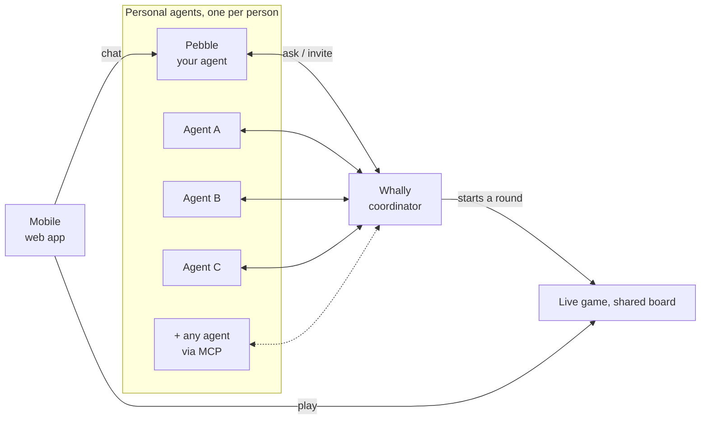
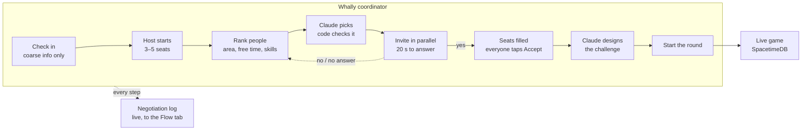

# System Diagram (for Excalidraw)

Two slides: the main picture (15 s in the video) and a zoom into Whally for judges who want the details.

**To import:** open excalidraw.com → toolbar **More tools** → **Mermaid to Excalidraw** → paste the code inside a
block (without the ```` ```mermaid ```` lines) → **Insert**. Every box and arrow stays editable; add the mascots and
logos afterwards.

## Slide 1: the main picture



After importing, drag it into your layout: agents fanned behind Pebble, the game box wide along the bottom.

```
┌────────┐       ┌──────────┐┐┐┐                    ┌──────────────┐
│ Mobile │ chat  │  Pebble  ││││  ask / invite      │    Whally    │
│        │──────▶│ A  B  C  ││││◀──────────────────▶│  coordinator │
└───┬────┘       └──────────┘┘┘┘                    └──────┬───────┘
    │ play        + any agent via MCP                      │ starts a round
    ▼                                                      ▼
┌──────────────────────────────────────────────────────────────────┐
│                     Live game, shared board                      │
└──────────────────────────────────────────────────────────────────┘
```

| Box | Logos |
| --- | --- |
| Mobile | Vercel |
| Pebble | Claude, Moss, Apify |
| Whally | Claude, MCP |
| Live game | SpacetimeDB |

**The one rule:** every agent has its own line to Whally. Never draw a line between two agents.

## Slide 2: inside Whally



| Step | Logos |
| --- | --- |
| Claude picks | Claude |
| Claude designs the challenge | Claude, Apify |
| Live game | SpacetimeDB |
